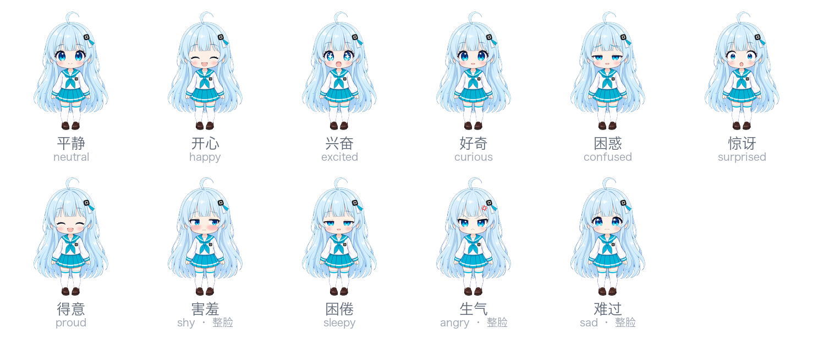
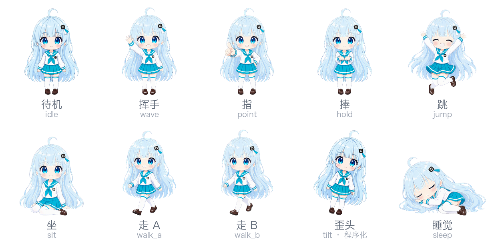
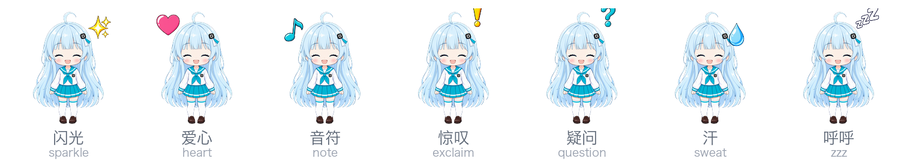

<p align="center">
  
</p>

<h1 align="center">Step酱 · 桌面宠物</h1>

<p align="center">
  macOS 桌面上一个无背景、常驻置顶的 AI 桌宠。<br>
  全双工实时语音，分层骨架 + 程序化动画，菜单栏配置。<br>
  在你允许的前提下，她能看一眼你的屏幕、知道你在用什么应用、接住你拖过去的文件。
</p>

<p align="center">
  
</p>

<p align="center">
  <sub>Tauri 2 + React 19 + PixiJS 8 + Rust。没有服务端进程，产物就是一个 <code>.app</code>。</sub>
</p>

> 上面这段动画是**用仓库里的素材按渲染器的几何参数逐帧重演**的，不是录屏 ——
> 桌宠窗是透明置顶的，真机录屏会把当时的桌面内容一起拍进来。
> 图层偏移、FX 大小与落点、歪头的 12.6° 都取自 `rig.json` 和 `RigRenderer`，
> 所以叠法和真机一致；但呼吸、随机眨眼、挤压拉伸、口型这些**程序化**动画只能在真机上看到。

**当前状态与验证证据见 [PROGRESS.md](PROGRESS.md)** —— 里面写清了哪些真跑过、哪些还没验。

---

## 下载

去 [Releases](../../releases) 拿 `.dmg`，拖进「应用程序」。

**首次打开会被 Gatekeeper 拦住**，因为这个包是 ad-hoc 签名（`signingIdentity: "-"`），
没有 Apple 开发者证书、也没做公证。右键点图标 → **打开** → 再确认一次就行；
或者 `xattr -dr com.apple.quarantine "/Applications/Step酱.app"`。

然后需要一个[阶跃星辰](https://platform.stepfun.com/)的 API key。两种给法：

- 菜单栏图标 → **设置** → 填进去（写到 `~/.stepchan/.env`，权限 0600，**立即生效不用重启**）
- 或者自己建 `~/.stepchan/.env`，写 `STEPFUN_API_KEY=sk-...`

没有 key 她能显示、能被摸，但不会说话 —— 右键「和 Step酱 说话」会明确告诉你拿不到凭据。

## 从源码运行

需要 Node ≥ 22.12（实测 26.8.1）、Rust（实测 1.98.1）、macOS 13+（实测 26.6.2）。

```bash
cp .env.example .env     # 填 STEPFUN_API_KEY
npm install
npm run dev
```

**语音功能必须在打包产物上验收，`tauri dev` 下麦克风可能静默失败** —— dev 跑的是裸二进制，
不是带 usage description 和 entitlements 的签名 bundle：

```bash
npm run build:debug
open "apps/desktop/src-tauri/target/debug/bundle/macos/Step酱.app"
```

从构建产物目录直接打开**不会被 Gatekeeper 拦**（quarantine 属性只在下载/AirDrop 时附加）。
完整的人工验收清单见 [docs/DESKTOP_QA.md](docs/DESKTOP_QA.md)。

浏览器里也能跑 `npm run web` 调界面，此时所有系统能力降级为不可用、凭据走 vite 的 dev-only 端点。
这条路径只是为了保留调试手段，不是产品形态。

## 用法

启动后她出现在屏幕右下角。**透明区域的点击会穿透到下层应用**，只有她身上能点、能拖。

| 操作 | 结果 |
|---|---|
| 直接开口说话 | 她听着呢（持续聆听默认开） |
| **长按**她 | 「闭嘴，听我说」—— 立刻打断她，不受打断开关限制 |
| **双击**她 | 开/关文字输入框 |
| 单击她 | 换一个表情/动作或冒一个效果件，偶尔搭句话 |
| 摸不同部位 | 头顶、脸颊、徽章、手各有不同反应 |
| `⌥Space` | 唤起输入框 |
| 右键她 / 菜单栏图标 | 语音开关、持续聆听、可打断、音色、大脑模式、三个感知开关、去睡觉、大小、设置、退出 |
| 往她身上拖文件 | 她会看文件名做反应（只读文件名，不读内容） |
| `Esc` | 关输入框；输入框没开时打断她（仅在 Step酱 是当前应用时有效，桌宠窗平时不抢键盘焦点） |

**想打断她，长按是可靠的那个办法。**「允许说话打断她」**默认关闭** ——
环境噪声和她自己从扬声器出来的回声都会被服务端 VAD 当成你在说话，
开着的话她会被不停掐断。关掉之后她把话说完；要插话就长按（或按 Esc）。

没互动 5 分钟（可配，0 = 不自动睡）她会自己打瞌睡。**睡着时不聆听、不显示气泡**，
任何操作都会把她叫醒并恢复聆听。也可以从右键菜单主动让她去睡。

设置窗里有**麦克风自检**：真的申请一次权限、开一次流、读一帧样本，然后逐步告诉你
断在哪一环。值得专门做一个，是因为「麦克风没权限」「语音开关关着」「设备被别的应用占用」
这三种情况的症状完全一样 —— 说完话什么都没发生。

## 她能感知什么

三项感知**默认全部关闭**，在菜单栏或设置窗口里开。关闭时她会明确说「你得先打开那个开关」，
而不是假装看不见：

| 能力 | 开启后 | 边界 |
|---|---|---|
| 看屏幕 | 截一张当前屏幕交给 `step-1o-turbo-vision`，聊你正在做的事 | 需系统「屏幕与系统录制」权限；每次都有可见提示；只在内存中处理，用完即删，**不落盘** |
| 知道前台应用 | 切换应用时她偶尔搭话 | 只读应用名和 bundle id，**不读窗口标题**（那需要辅助功能权限，没申请）；8 秒冷却 + 每分钟 4 次上限 |
| 读剪贴板 | 她需要时读一次文字 | 每次都有提示；不主动轮询；最多 4000 字 |
| 自己行动 | 空闲时换位置、主动搭话 | 不读取任何内容；**打盹不受这个开关约束** —— 那是被动的，只是换个姿势待着 |

**不保存聊天内容、不保存录音、不保存截图。** 只持久化开关、音色、大小、热键。
详见 [AGENTS.md](AGENTS.md) 的隐私条款 —— 原来那条「不读取其他窗口」的一刀切禁令本轮被显式改成了
上面这组条件，不是悄悄越过的。

## 大脑：两种模式

菜单栏里切。两种各有取舍，不是「新的更好」：

| | realtime（默认） | chat |
|---|---|---|
| 模型 | `stepaudio-3-realtime-preview` | `step-5-preview`（可选 `step-3.7-flash`） |
| 链路 | 一条 WebSocket 承载听/想/说/调工具 | ASR → chat completions → 按句 TTS |
| 延迟 | 说完到首帧音频实测 **235 ms**（最快 7 ms） | 明显更久，要等一句合成完 |
| 工具调用 | 弱 —— 会「口头答应」却不真调 | 强得多 |

混合模式（realtime 做交互、chat 承担智能）的可行性分析见
[docs/BRAIN_MODES.md](docs/BRAIN_MODES.md)：结论是「有条件可行，但得先验证 realtime 能不能被稳定
保持住」，接口已经按 `PetBrain` 抽好，两种实现靠编译期断言保证面一致。

## 语音

一条 WebSocket 承载整个对话回路，不再是「ASR → 对话 → 按句 TTS」的串行链路。

音色五种（元气少女 / 机灵少女 / 软萌女声 / 邻家妹妹 / 活力轻快），默认元气少女。
**换音色会重建会话** —— 模型首次出音后 `voice` 不可改。单会话上限 30 分钟，到期自动静默重建，
重建前会等她把话说完（最多 60 秒）再切，避免切在半句上。

几个实测结论，记在这里免得以后重新踩：

- **浏览器设不了 `Authorization` 头**，所以 webview 直连 realtime 必须用 subprotocol 带 key：
  `['realtime', 'openai-insecure-api-key.<KEY>']`。query param 形式会被拒。
- **用户语音转写的 delta 是「累计全量文本」，不是增量。** 拿它做 `+=` 会把一句话叠成好几遍。
  而她自己的 `response.audio_transcript.delta` 确实是增量 —— 两者不对称，别想当然。
- **她会声称做了没真做的事。** 说「挪到右下角去」她回「好的我这就挪」但一个工具都没调。
  现在文字和语音两条路径都有 `tool_choice` 收紧，且宁可降级成「我做不到」也不让她撒谎。
- **`response.cancel` 有尾巴。** 取消后还会到 4 个音频分片，不拦就会在被打断后又蹦出半个字。
  现在有抑制闸门，到下一个 `response.created` 才打开（并带 1.5 秒硬超时，防止闸门卡住让她整轮静音）。
- **「不可打断」只做客户端是不够的。** 服务端 VAD 照常收音，静音 700 ms 后它会自己 commit、
  自己开新回合，在**服务端**把她截断 —— 而协议里没有「要断句但不要自动开回合」的字段。
  所以她说话期间干脆不给服务端音频：停止上传并清空缓冲，没有音频就没有回合。

PCM 采样率是 **24000**，文档没写。确定方法是测服务端自己报的 `audio_end_ms` 在两种缓冲长度下的
**斜率**以抵消 VAD 偏移；单点读数不可用，而「时长对比文本长度」这种启发式会给出错误答案
（同一音色同一文本的语速能差 2 倍）。

## 美术

角色是 Q 版重绘，保留原立绘的全部识别特征（呆毛、浅蓝长发、水手服配青绿领、青绿百褶裙、step 徽章）。
原始素材 `assets/blue_pet_assets_v0_2/` 保留未改。

### 11 个表情



### 10 个动作



### 7 个一次性效果件



流水线在 `tools/art/`，prompt 的唯一来源是 `character.py`：

1. `/images/generations` + `background=transparent` 出 Q 版候选，筛选后定为 `master.png`
   —— 筛选是把候选缩到 220 px 放在浅色和深色底上比，因为那才是真实显示条件；
   同样条件下 `high` 相对 `medium` 看不出差别，所以变体一律用 `medium`
2. 从 master 出发用 `/images/edits` 派生所有变体 —— **edits 会忽略 `background=transparent`**，
   所以走「纯品红幕布 + 本地抠色」（实测晕边 0.35%）
3. 每个变体与 master 做像素 diff，变化区域紧凑的裁成配准覆盖层，不紧凑的降级为整图交叉淡入
4. 归一化、阈值化 alpha（模型给的主体 alpha 上限只到 253–254）、降采样到 512 px，写 `rig.json`

**分层是算出来的，不是声称的。** 原 manifest 当初禁止脸部合成，就是因为没人验证过配准。
现在 11 个表情里 8 个真分层，3 个（上图标「整脸」的害羞 / 生气 / 难过）因为要画腮红、
怒气符号、眼泪而降级为整脸图交叉淡入；10 个动作里 9 个有独立姿势，`tilt` 三版 prompt 都没能
让模型真的歪头，于是改成渲染器对整身图做 12.6° 旋转 —— 头身比 40% 的 Q 版，整体倾斜在视觉上
就读作歪头。每一条降级都带原因写在 `rig.json` 的 `degraded` 里，**没有任何动作是静默空转的**。

动画是程序化的，不靠堆逐帧素材：呼吸、随机眨眼（带偶发连眨）、摇摆、拖拽时的挤压拉伸与惯性、
落地回弹、表情 150 ms 交叉淡入、口型由播放音频的 RMS 驱动（不是按文字节奏瞎摆）、
发饰上那枚徽章有滞后抖动（身体停下的瞬间它还在晃）。

视觉 QA 拼版：`assets/stepchan_q_v1/_qa_220.png`（全身，浅底 / 深底 / 棋盘格）
与 `_qa_faces.png`（脸部特写）。

上面这三张表和顶部的动画由 `tools/art/readme-images.py` 按 `rig.json` 的真实几何合成
（图层偏移、FX 边长 = 画布高 × 0.22、FX 落点、歪头 12.6°，全部照抄 `RigRenderer` 的常量），
改了素材重跑 `python3 tools/art/readme-images.py` 就能更新。
它连「覆盖层只在 `idle` 和程序化动作上成立」这条规则也照搬了 —— 不照搬的话睡觉姿势会被叠上
表情层，眼睛飘到头顶去，而那正是应用里真实发生过的一个 bug。

## 代码地图

```
apps/desktop/src-tauri/      Rust：窗口 / 托盘 / 热键 / 系统能力 / key 保管
  window.rs                  透明置顶窗口、全屏共存、位移补间
  hittest.rs                 光标轮询驱动的点击穿透（为什么必须在 Rust 侧，见文件头）
  tray.rs                    菜单栏菜单与全局热键
  settings.rs                设置读写 + 跨窗口广播（白名单与 zod schema 有 parity 测试）
  credentials.rs             .env 定位与 key 写入
  os/                        截屏、前台应用、电量、剪贴板
apps/web/src/
  App.tsx                    唯一的集成层：把下面几块缝起来
  brain/                     人设、工具执行、会话编排
    chat/                    chat 模式的另一套实现（ASR / SSE / 按句 TTS）
  voice/                     realtime 客户端、麦克风与播放 worklet、打断
  pet/                       Pixi 骨架渲染器与程序化动画
  awareness/                 主动感知：前台应用搭话、拖放反应、空闲行动与打盹
  platform/                  Desktop 契约的两套实现（Tauri / 浏览器）
  ui/                        气泡、设置窗、纯函数判断（uiState.ts）
shared/                      冻结契约：realtime / pet / desktop / brain
tools/art/                   素材生成流水线
```

三块业务层（`brain` / `pet` / `awareness`）互相不 import，耦合只落在 `App.tsx`。
系统能力一律走 `shared/desktop.ts` 的 `Desktop` 契约 —— 这也是将来移植 Android 的接缝。

## 检查

```bash
npm test                 # 453 个用例
npm run typecheck
npm run build:web
npm run build:debug      # 语音/权限只能在这个产物上验
npm run build            # 发布包（.dmg + .app）
cd apps/desktop/src-tauri && cargo check

node scripts/realtime-probe.mjs   # 会用真实 API 额度：鉴权、VAD、工具调用、打断
```

测试里有相当一部分是**回归测试**，每条都对应一个真实发生过的故障，而且都验证过
「还原对应修复就报红」—— 这个项目踩过太多次**无声失败**（开关点了没反应、
点她只换表情不说话、ASR 气泡永久卡住、活动状态卡在 thinking），症状在界面上看不出哪儿断了，
不先钉住就无法确认修好了。几个例子：

- 设置的形状有两个真相源（zod schema 与 Rust 白名单），少一个键就静默丢弃 → 解析 Rust 源码逐键比对
- 音色清单也有两份（设置窗 / 托盘），标签漂成过两个名字 → 同样逐项比对
- 「她在说话」如果用瞬时音量判断，欠载那一瞬就会被判成没在说话 → 用去抖后的状态，并有专门用例
- 新增设置项忘了接线 → 遍历 schema 全部键逐个翻值，断言结果不是悄悄的「什么都不做」

素材接口的真实行为（透明背景、分辨率下限、400 重试、`edits` 的坑）记在
`~/Desktop/gpt-image-lab/docs/findings.md`，本项目发现的结论都已回填进去。

设计来源 `docs/StepChan_Character_Bible_v1.md`（人设，仍然有效）、
`docs/StepChan_Technical_Design_v0_3.md` 与 `sources/`（Web MVP 时期的方案，已被本版取代，
保留作历史）。`DELIVERY_MANIFEST.json` 是启动包的历史快照，不是当前清单。

## 已知边界

- **只验过 macOS。** Tauri 的窗口/托盘/命中穿透是按 macOS 写的，Android 移植只预留了接缝（`Desktop` 契约），没做。
- **包是 ad-hoc 签名的**，不是公证过的分发包，所以首次打开要绕一次 Gatekeeper（见上）。
- **「不可打断」依赖一个推断**：协议里没有「要 VAD 断句但不要自动开回合」的字段，
  所以靠「她说话期间不上传音频」绕过。理论上服务端没音频就开不了回合，但这条没有抓包证实。
- 单会话 30 分钟上限由服务端规定，到期静默重建；重建会带一段上下文摘要过去，而不是全量重灌。

## 许可

仓库里还没有 LICENSE。角色设计源自 `assets/blue_pet_assets_v0_2/` 的原始立绘，
Q 版重绘由 `tools/art/` 的流水线生成 —— 这部分的授权状况请以原始素材的来源为准，
在补 LICENSE 之前不要默认可以随意再分发。
